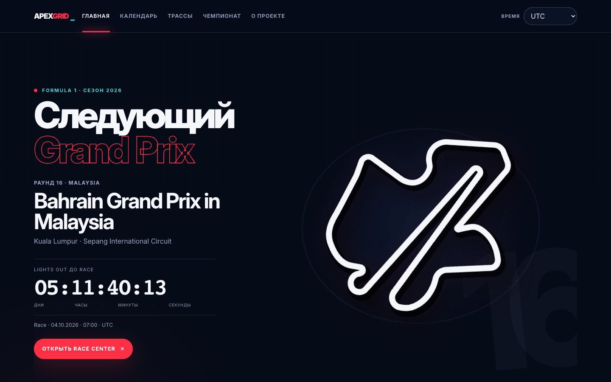
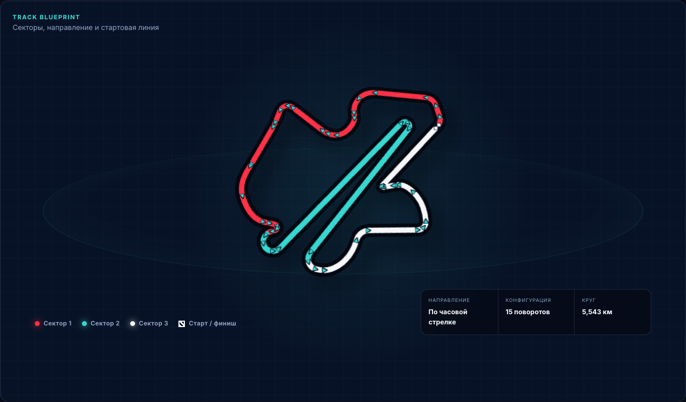
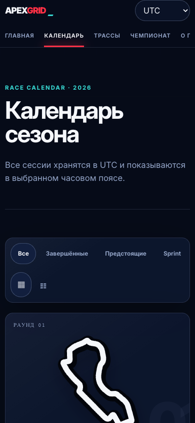
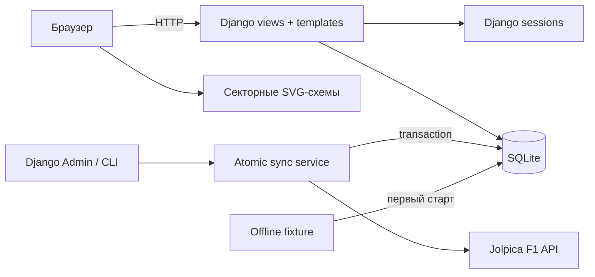
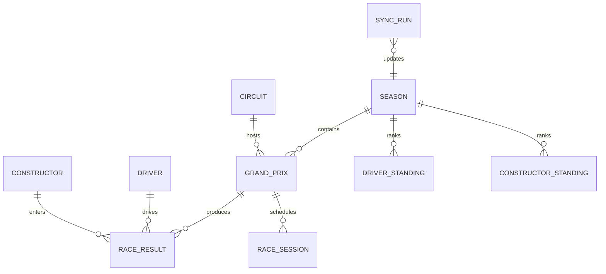

# ApexGrid

Интерактивный календарь сезона Formula 1 на Django: полное расписание 2026 года, статистика чемпионата, локальное время и технические схемы всех трасс. Проект полностью работает из офлайн-снимка, а свежие данные можно безопасно подтянуть из Jolpica F1 API.


<p align="center">
  <strong>Django 5.2 · SVG · SQLite · Docker · Gunicorn · WhiteNoise</strong>
</p>

## Живая демонстрация интерфейса



| Техническая схема трассы | Мобильный календарь |
|---|---|
|  |  |

## Что умеет проект

- показывает все 23 Grand Prix сезона 2026 прямо на главной странице, с флагами стран;
- собирает практики, Qualifying, Sprint и Race в однозначную хронологическую шкалу по дням;
- переводит UTC-время в выбранный пользователем часовой пояс;
- хранит часовой пояс, вид календаря и избранные этапы в Django session;
- фильтрует календарь по завершённым, предстоящим и Sprint-этапам без перезагрузки;
- рисует реальные контуры трасс как яркие секторные SVG-схемы со стартом, направлением и технической легендой;
- показывает локальные логотипы всех 11 команд в standings и результатах;
- показывает результаты гонок и standings пилотов/команд;
- запускается без сети благодаря локальному snapshot на 560 объектов;
- обновляет данные по кнопке из защищённого Django Admin или командой;
- сохраняет SQLite между перезапусками Docker-контейнера;
- адаптирован для телефона, клавиатуры и режима `prefers-reduced-motion`.

## Быстрый запуск через Docker

Нужен только Docker Desktop.

```bash
cd apexgrid
cp .env.example .env
# заменить DJANGO_SECRET_KEY в .env на длинное случайное значение
docker compose up --build
```

Открыть: <http://localhost:8000>

При первом старте контейнер автоматически выполняет миграции, загружает offline-snapshot и собирает статику. При следующих стартах база не перезаписывается: команда выводит `skipped: в базе уже есть сезон`.

Остановка без удаления данных:

```bash
docker compose down
```

Полный сброс демонстрационной БД:

```bash
docker compose down -v
```

## Обычный локальный запуск

Требуется Python 3.13+.

```bash
python -m venv .venv
source .venv/bin/activate
pip install -r requirements-dev.txt
python manage.py migrate
python manage.py seed_demo
python manage.py runserver
```

Сайт будет доступен на <http://127.0.0.1:8000>.

## Как это работает простыми словами

1. Браузер просит у Django страницу календаря или выбранного Grand Prix.
2. Django берёт структурированные данные из SQLite и собирает HTML-шаблон.
3. Небольшие JavaScript-модули добавляют фильтры, countdown и смену предпочтений.
4. Контур трассы хранится как SVG path. Шаблон повторно использует его для трёх цветных секторов, направления движения и стартовой линии — без тяжёлого рендеринга и зависимости от WebGL.
5. Выбор пользователя хранится только в cookie с идентификатором Django session; аккаунт посетителю не нужен.
6. Если сети нет, сайт продолжает работать. Jolpica вызывается только при явной синхронизации администратором.

## Архитектура



Ключевая идея — **offline-first**. Публичные страницы никогда не ждут внешний API. Сервис синхронизации сначала получает и валидирует полный набор данных, затем заменяет связанные записи в одной транзакции. При ошибке старая версия остаётся целой.

Подробности: [архитектура и модель данных](docs/architecture.md).

## Модель данных



## Синхронизация данных

Из терминала:

```bash
python manage.py sync_f1 --season 2026
```

Из интерфейса:

```bash
python manage.py createsuperuser
```

После входа на `/admin/` выбрать **«Обновить F1 2026»**. GET-запрос только показывает подтверждение; изменение данных выполняет защищённый CSRF-токеном POST. Результат каждого запуска сохраняется в `SyncRun`, а технический traceback пользователю не показывается.

## Настройки окружения

Пример находится в [.env.example](.env.example).

| Переменная | Назначение | Локальное значение |
|---|---|---|
| `DJANGO_SECRET_KEY` | секрет Django | заменить перед публикацией |
| `DJANGO_DEBUG` | debug-режим | `false` в Docker |
| `DJANGO_ALLOWED_HOSTS` | разрешённые host headers | `localhost,127.0.0.1` |
| `DJANGO_SECURE_COOKIES` | включает Secure сразу для session и CSRF cookie | `false` для HTTP |
| `DJANGO_DB_PATH` | путь к SQLite | `/data/db.sqlite3` в Docker |
| `APEXGRID_PORT` | внешний порт Compose | `8000` |
| `JOLPICA_BASE_URL` | endpoint данных | официальный Jolpica endpoint |

Для публичного HTTPS-развёртывания нужно включить `DJANGO_SECURE_COOKIES=true`, настроить TLS/redirect и HSTS на приложении или reverse proxy. С HTTP-настройками из Compose `check --deploy` ожидаемо напоминает о четырёх пунктах: HSTS, HTTPS redirect и двух Secure-cookie. После включения secure cookies остаются две рекомендации для TLS-слоя.

## Проверки

```bash
python manage.py check
python manage.py makemigrations --check --dry-run
python manage.py test -v 2
python -m pytest tests/browser -v
python manage.py collectstatic --noinput
./scripts/smoke_docker.sh
```

Browser smoke проверяет секторную схему, хронологию расписания, отсутствие переполнения на мобильном экране и загрузку логотипов только с локального сервера. Docker smoke собирает образ, ждёт `/health/` и открывает четыре основных маршрута.

## Структура проекта

```text
apexgrid/
├── config/                 # settings, URLconf, WSGI
├── core/                   # главная, preferences, health, error pages
├── integrations/jolpica/   # HTTP-клиент, схемы и mapper'ы API
├── racing/                 # модели, страницы, sync service, fixture
├── static/                 # CSS, JS, локальные логотипы, шрифт Inter
├── templates/              # публичные и admin-шаблоны
├── tests/browser/          # Playwright smoke
├── scripts/                # media, snapshot и Docker smoke
└── docker/                 # production entrypoint
```

## Что показать на защите

Короткий сценарий на 4–5 минут находится в [docs/demo-script.md](docs/demo-script.md). Самые наглядные пункты:

1. главная с ближайшим Grand Prix и countdown;
2. фильтры и два вида календаря;
3. секторную схему трассы, стартовую линию и хронологию гоночного уик-энда;
4. смена UTC на московское время и сохранение после обновления страницы;
5. standings и результаты;
6. `/admin/` с безопасной синхронизацией;
7. повторный `docker compose up`: данные не перезагружаются.

## Возможные улучшения

Это идеи, **не реализованные в текущей версии**: live timing, карта погоды, сравнение пилотов, PostgreSQL и полноценное пользовательское избранное с аккаунтами.

## Источники и лицензии

- календарь и статистика — [Jolpica F1 API](https://api.jolpi.ca/ergast/f1/), CC BY-NC-SA 4.0;
- контуры и параметры трасс — [F1DB](https://github.com/f1db/f1db), CC BY 4.0;
- логотипы команд — локальные файлы из Wikimedia Commons и официальный media asset Racing Bulls;
- Inter — SIL Open Font License 1.1.

Полный список и сохранённые тексты лицензий: [THIRD_PARTY_LICENSES.md](THIRD_PARTY_LICENSES.md).

ApexGrid — неофициальный учебный некоммерческий проект, не связанный с Formula 1 или FIA. Названия соревнований, команд и трасс принадлежат их правообладателям.

## Troubleshooting

- **Порт 8000 занят:** запустить `APEXGRID_PORT=8080 docker compose up --build`.
- **Нужен чистый snapshot:** выполнить `docker compose down -v`, затем поднять проект снова.
- **Логотип не обновился:** пересобрать статику командой `python manage.py collectstatic --noinput` или пересобрать Docker image.
- **Jolpica недоступен:** продолжить работу с локальными данными и повторить sync позже.
- **Статика не обновилась:** выполнить `python manage.py collectstatic --noinput` или пересобрать image.
