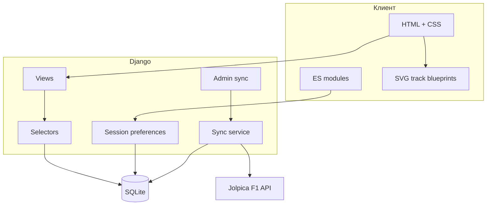
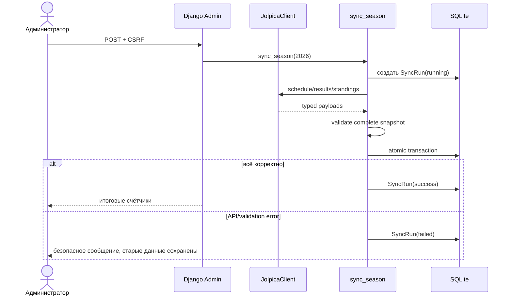

# Архитектура ApexGrid

## Границы системы

ApexGrid — server-rendered Django-приложение. Публичный запрос не зависит от внешних сервисов: views читают локальную SQLite, selectors формируют выборки, templates создают HTML. JavaScript используется как progressive enhancement — базовая навигация и данные доступны без него.

## Приложения

- `core` — главная страница, healthcheck, session preferences, 404/500;
- `racing` — доменная модель Formula 1, selectors, public views, admin и атомарная синхронизация;
- `integrations.jolpica` — изолированный HTTP adapter: retry, пагинация, проверка JSON и mapping во внутренние dataclass-схемы.

## Поток синхронизации

Перед транзакцией загружаются все четыре набора. Поэтому сетевой сбой не может оставить половину нового календаря рядом с половиной старых результатов.

## Конвейер схемы трассы

`Circuit.geometry` хранит `viewBox` и строку SVG path. Django-шаблон использует один и тот же path в четырёх слоях:

1. тёмная подложка отделяет маршрут от координатной сетки;
2. три линии с `pathLength=100` и разными `stroke-dashoffset` показывают условные секторы;
3. SVG markers отмечают направление движения;
4. клетчатый marker показывает старт и финиш;
5. HTML-легенда и технические показатели остаются доступны скринридеру.

Схема рендерится без JavaScript, Canvas и WebGL, поэтому одинаково работает в Docker, мобильном браузере и режиме экономии энергии.

## Хранение состояния

Посетителю не нужен аккаунт. Django session хранит только:

- `timezone`: `UTC` или `Europe/Moscow`;
- `calendar_view`: grid/list;
- список избранных Grand Prix.

Основная база в Docker расположена в named volume `apexgrid_data`. `seed_demo` проверяет наличие сезона и никогда не затирает существующие записи.

## Production-контур

Gunicorn обслуживает WSGI, WhiteNoise — fingerprinted static assets. Контейнер работает непривилегированным пользователем `apexgrid`; entrypoint выполняет migrate → idempotent seed → collectstatic → Gunicorn. Compose healthcheck обращается к `/health/`, который дополнительно проверяет доступность БД.
